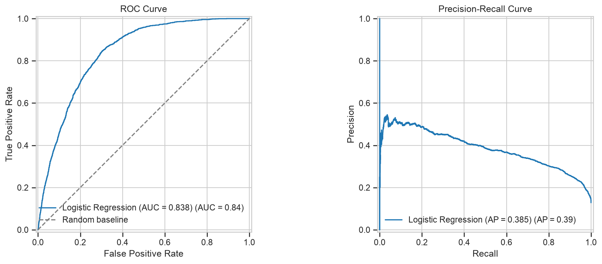
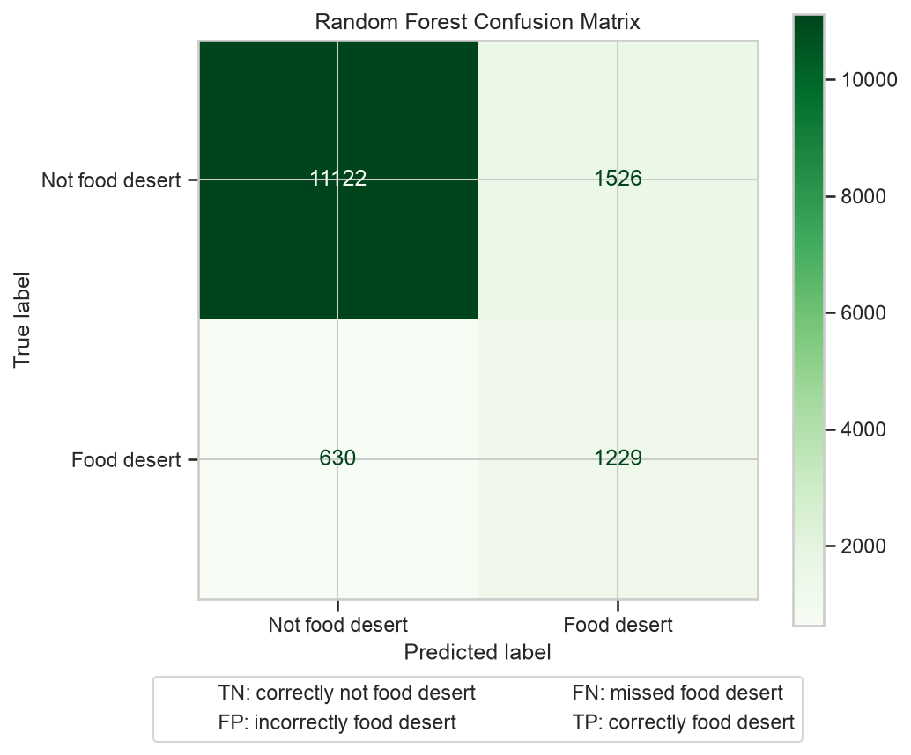
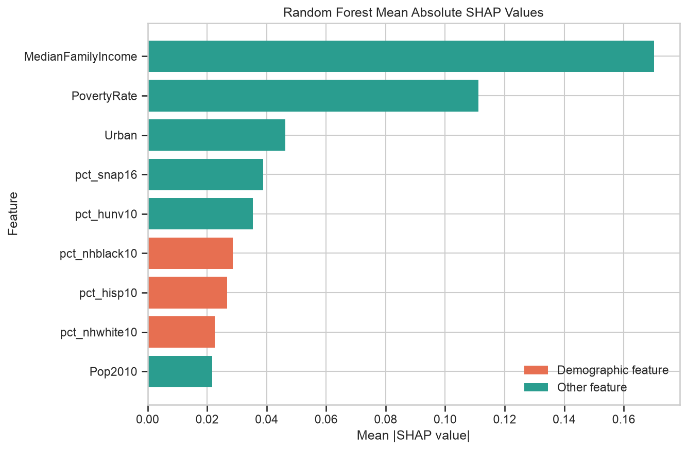
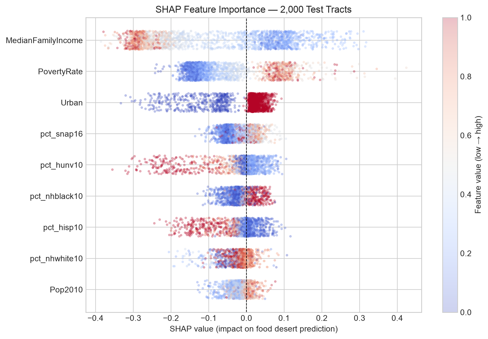
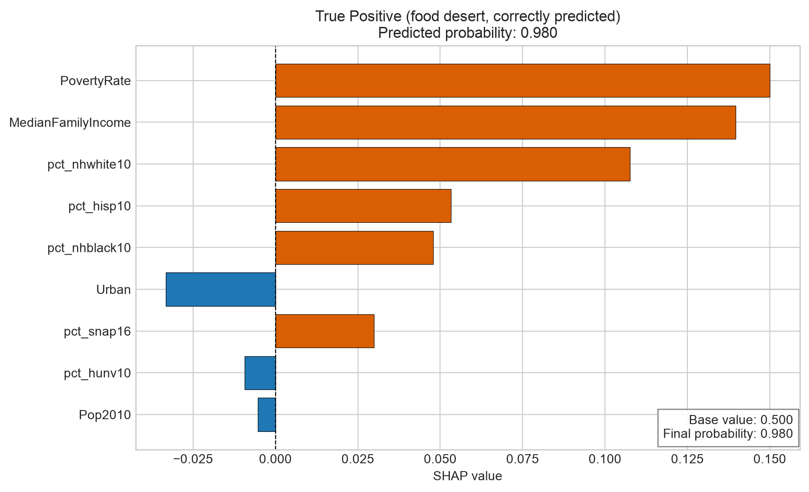
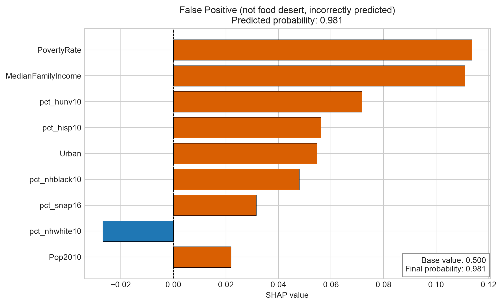
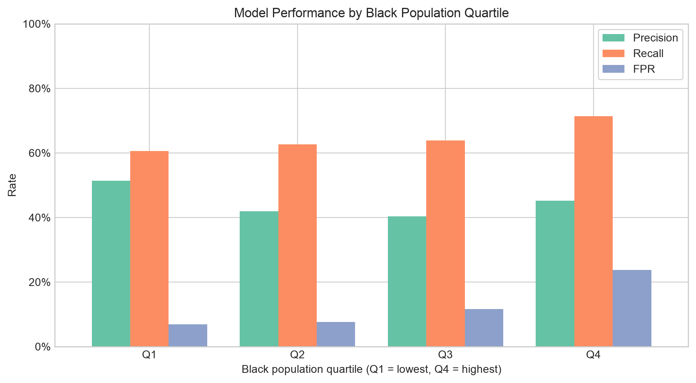
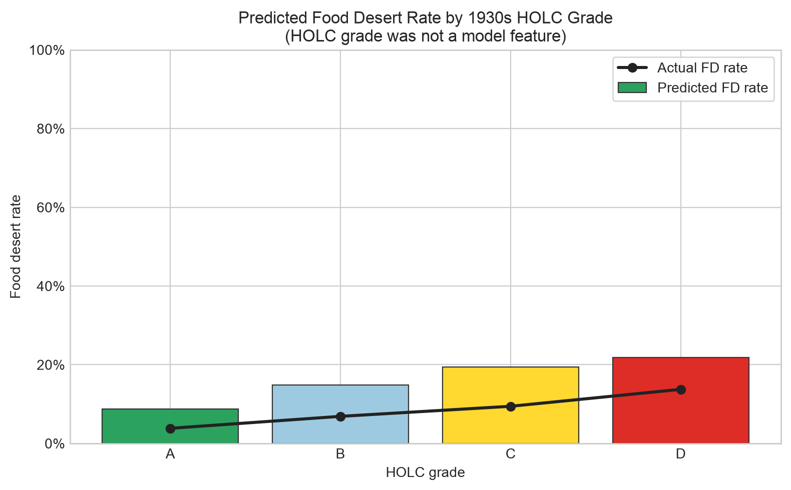
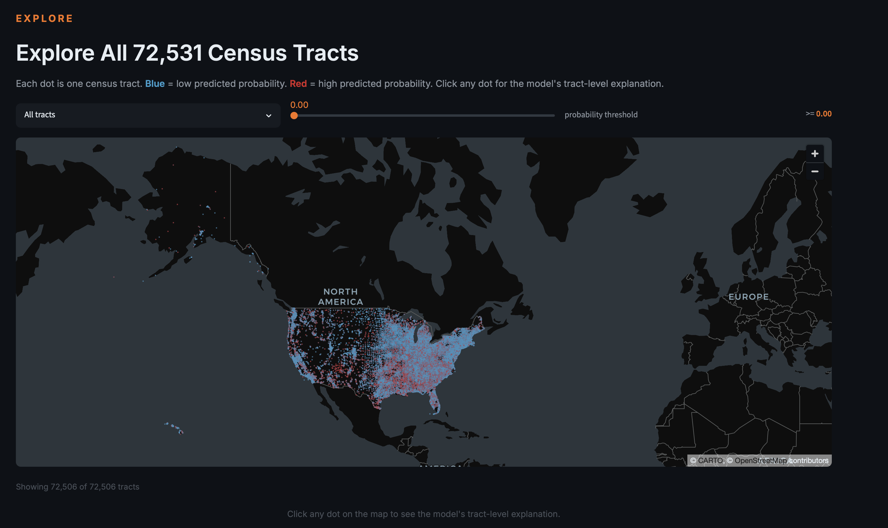

# DesertMap

**Predicting food desert status across 72,531 U.S. census tracts and auditing the model for redlining-era racial bias**

AI4ALL Ignite Accelerator portfolio project

---

## The Finding

We trained a Random Forest classifier to predict which census tracts qualify as USDA-defined food deserts using nine modern socioeconomic and demographic features. No historical redlining data was included.

When we overlaid the model's predictions on 1930s HOLC redlining maps, a stark pattern emerged. Tracts historically graded C or D ("Declining" / "Hazardous") are **1.53 times more likely** to be predicted food deserts than A or B graded tracts (20.3% vs. 13.3%). The model learned the geography of 1930s discrimination from present-day data, without ever being shown it. That geography is real: actual food desert rates differ by 1.82x between the same grades.

Four separate bias audits point the same way. Responsible deployment requires detecting it first.

---

## Dataset

**Source:** USDA Food Access Research Atlas 2019, national scope, census tract level

| Split | Tracts | Class balance |
|---|---|---|
| Training (80%) | 58,024 | ~12.8% food desert |
| Test (20%) | 14,507 | ~12.8% food desert |

**Target variable:** `LILATracts_1And10`: low income AND low access at 1-mile urban / 10-mile rural threshold

**Features (9):** Median family income, poverty rate, % Black population, % Hispanic population, % White population, % households with no vehicle, % SNAP-enrolled households, total population (2010), urban/rural flag

No HOLC redlining data, ZIP codes, or neighborhood names were used in training.

---

## Model Results

| Model | F1 | Precision | Recall | ROC-AUC |
|---|---|---|---|---|
| Logistic Regression (baseline) | 0.438 | 0.302 | 0.800 | 0.838 |
| **Random Forest** | **0.533** | **0.446** | **0.661** | **0.885** |

F1 is the primary metric given the roughly 7:1 class imbalance. The Random Forest improves F1 by 9.4 points and precision by 14.4 points over the baseline, with a 0.885 ROC-AUC. The baseline has higher recall because it flags far more tracts.





---

## Explainability

SHAP (SHapley Additive exPlanations) values come from path-dependent TreeSHAP on all 72,531 tracts (`scripts/tract_shap.py`); each tract's values plus the base rate add up to its predicted probability.

**Global feature importance:** Median family income and poverty rate are the dominant drivers. Racial composition features rank lower overall (% Hispanic 6th, % Black 8th of 9); the audit below measures how much they still move individual predictions.





**Tract-level explanations:** The waterfall plots below show individual predictions: a true positive (correctly flagged food desert) and a false positive (incorrectly flagged).





---

## Bias Audit

Four methods, all on the same tuned model. All four point the same way.

### 1. Race-Removed Model Delta

Retraining the model with all three race shares removed (% Black, % Hispanic, % White) reduces F1 by **4.7 points** (0.533 to 0.486). All three are removed together because the three race shares sum to nearly 100%, so any one left in reveals the others; removing only % Black and % Hispanic costs 3.8 points. Racial features carry predictive signal beyond income and poverty rate.

### 2. Quartile False Positive Rate Analysis

Census tracts were grouped into quartiles by Black population share. The false positive rate in the highest quartile is **3.5 times** that of the lowest (23.8% vs. 6.9%).



### 3. Counterfactual Racial Composition Probe

For each of the 2,755 held-out tracts predicted as food deserts, all three race shares were set to their held-out median with every other feature fixed. **16.4% of those predictions flipped** to "not a food desert" (452 of 2,755). Race alone decides about one in six positive predictions. An earlier version reset only % Black and % Hispanic and flipped 22.0%, but it left many tracts with race shares that no longer added up.

### 4. HOLC Post-Prediction Overlay

The HOLC crosswalk (Mapping Inequality v3, Nelson et al. 2023) maps 1930s neighborhood grades to 2010 census tract boundaries. This data was never used in training. Tracts overlapping C- or D-graded areas have a **1.53x higher predicted food desert rate** than those overlapping A- or B-graded areas. On held-out tracts alone the ratio is 1.30x; actual food desert rates show 1.82x, so the model tracks a real gap and predicts it slightly flatter.



---

## Limitations & Interpretation

**The confounding variable challenge:** Redlined areas became low-income areas; low-income areas have poor food access. The overlap with HOLC maps might simply reflect income concentration rather than race.

The counterfactual test addresses this directly. All three race shares were set to their held-out median while holding income, poverty rate, and all other features constant. 16.4% of positive predictions flipped. If the pattern were purely income geography, removing race should not move individual predictions. It does.

Even if the pattern is income geography, that geography aligns with 90-year-old federal grading maps, and the explanation for that match is the redlining story.

**What this study can and cannot claim:** This is observational. Causation is not established. The finding is that (1) the pattern shows up in four tests, (2) racial composition carries predictive signal beyond income and poverty, and (3) that is sufficient reason to audit the model before any deployment affecting food access decisions. Responsible use calls for disclosing the disparity, whether or not the causation question is settled.

---

## Interactive Site

A static web app shows predictions for all 72,531 tracts, with tract-level SHAP explanations. The two-page [model card](docs/model_card/desertmap_model_card.pdf) summarizes the model, data, metrics and limits.



**Live site:** [desertmap.vercel.app](https://desertmap.vercel.app)

Run it locally:

```bash
uv sync
uv run python scripts/export_static_data.py
cd site && python3 -m http.server 8000
```

Then open http://localhost:8000. Rebuild the model card (needs `brew install tectonic`):

```bash
uv run python docs/model_card/make_assets.py && tectonic docs/model_card/model_card.tex
```

Then copy `docs/model_card/model_card.pdf` to `docs/model_card/desertmap_model_card.pdf` and `site/model-card.pdf`.

Tests: `npm test` (site JavaScript) and `uv run pytest tests -q` (export and data checks).

---

## Reproducing the Full Pipeline

Run notebooks in order:

```bash
uv sync
uv run jupyter lab

# 01_eda.ipynb          exploratory analysis and class distribution
# 02_cleaning.ipynb     feature engineering and data quality
# 03_baseline_model.ipynb logistic regression baseline
# 04_random_forest.ipynb  random forest + SHAP
# 05_fairness_audit.ipynb fairness audit: HOLC overlay, quartile FPR
# 06_xai.ipynb          deep XAI: beeswarm, dependence, waterfalls, heatmap
```

All output figures write to `outputs/figures/`. Predictions and SHAP values write to `outputs/tract_predictions_shap.parquet`.

---

## Repository Structure

```
desertmap/
├── data/
│   ├── raw/                    # USDA Atlas, HOLC crosswalk, census centroids
│   └── processed/              # Cleaned and merged data
├── notebooks/
│   ├── 01_eda.ipynb
│   ├── 02_cleaning.ipynb
│   ├── 03_baseline_model.ipynb
│   ├── 04_random_forest.ipynb
│   ├── 05_fairness_audit.ipynb
│   └── 06_xai.ipynb
├── site/
│   ├── index.html
│   ├── styles.css
│   ├── js/
│   ├── data/
│   └── model-card.pdf
├── scripts/
│   └── export_static_data.py
├── tests/
├── docs/
│   ├── model_card/
│   ├── proposal.md
│   ├── smart_goals.md
│   ├── bias_identification.md
│   └── fairness_audit.md
├── outputs/
│   ├── figures/
│   ├── tract_predictions_shap.parquet
│   ├── baseline_metrics.json
│   ├── rf_metrics.json
│   └── fairness_metrics.json
├── pyproject.toml
├── uv.lock
└── README.md
```

---

## Data Sources

| Dataset | Source |
|---|---|
| USDA Food Access Research Atlas 2019 | ers.usda.gov |
| HOLC Neighborhood Grades Crosswalk | Mapping Inequality v3, Nelson et al. (2023) |
| Census Tract Population Centroids | U.S. Census Bureau, 2010 |

## CodeRabbit Integration
Testing CodeRabbit PR review automation.

